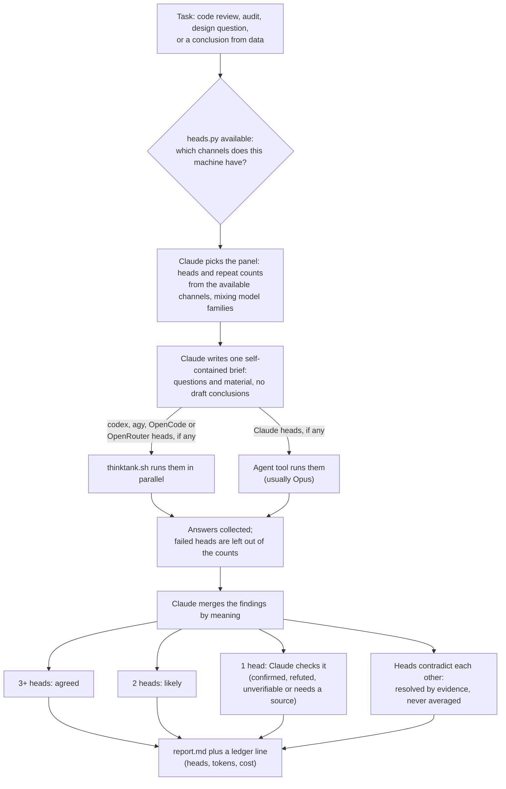
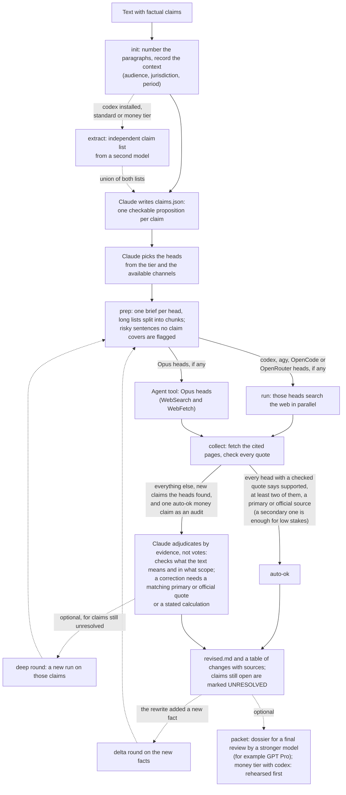

# thinktank (Claude Code plugin)

Two skills:

- `/thinktank:thinktank` fans one self-contained brief to several cheap LLM heads in parallel (codex, Gemini via agy, Opus via the Agent tool), merges findings by agreement, verifies single-head findings and reports tokens. For code reviews, audits, brainstorms, architecture questions and conclusions from data.
- `/thinktank:factcheck` checks a text claim by claim with web-enabled heads, verifies every cited quote against the live page, and writes a corrected text with sources. Optionally it also writes a dossier for a final review by a stronger model (for example GPT Pro); nothing requires one.

## How it works

**ThinkTank.** One brief goes to several independent heads at once. Agreement between heads is the signal; a finding only one head saw is checked by the orchestrator before it reaches the report.



With only Claude available, the runner is skipped: three Opus heads for reviews and data conclusions, two Opus and one Sonnet for brainstorms, two Opus for narrow questions, and the report says "single model family". With fewer than three live heads the report is labeled "degraded panel". Anything a head says needs a source is checked against a real source or marked unverified.

**FactCheck.** Every claim is checked against the web by several heads. A script then fetches each cited page and checks the quotes: exact and near-exact matches count, and a quote from a page this machine cannot read counts only when two heads bring it independently (for money claims Claude opens such pages itself). Verdicts without such evidence do not count.



If fewer than two heads return a usable answer, the run is labeled "degraded" and Claude checks every claim itself.

## Install

```
/plugin marketplace add tony8stark/thinktank
/plugin install thinktank@thinktank
```

Then ask for it in plain words ("run a thinktank review of this diff", "fact-check this article") or call `/thinktank:thinktank` and `/thinktank:factcheck` directly.

Update to the latest version:

```
/plugin marketplace update thinktank
/plugin update thinktank@thinktank
```

and restart Claude Code. Changes are listed in [CHANGELOG.md](CHANGELOG.md).

Optional reminder hook: copy `hooks/thinktank-check.sh` somewhere and register it as a `UserPromptSubmit` hook in `~/.claude/settings.json`.

## Requirements

Only Claude Code is required. The skills detect what else is installed and size the panel from it:

| installed | panel |
|-----------|-------|
| Claude Code only | Opus (and Sonnet) heads via the Agent tool; works, but one model family shares blind spots |
| + [codex CLI](https://github.com/openai/codex), signed in | codex heads (`gpt-6.1-sol`, low effort) carry the repeats, Opus adds a second family; recommended |
| + `agy` (Antigravity CLI) | adds a Gemini head |
| + `OPENROUTER_API_KEY` in the environment | OpenRouter heads (`or-gpt`, `or-gemini`, `or-deepseek`): other model families without installing their CLIs; paid per call |
| + [OpenCode](https://opencode.ai) CLI, 1.x or 2.x | any model you have set up in OpenCode, once you add a head for it (below) |
| + a local model server: [Ollama](https://ollama.com), [LM Studio](https://lmstudio.ai) (or LM Studio Bionic), llama.cpp, vLLM, Jan | local heads you add yourself (below): private and free per call, but weaker than hosted models; ThinkTank only, never picked automatically |

Also `python3` and `perl` (preinstalled on macOS and most Linux distributions). For factcheck, optionally `pdftotext` (PDF quotes; `brew install poppler` or `apt install poppler-utils`) and Chrome or Chromium for JS-heavy pages (found automatically; set `THINKTANK_CHROME` to a binary to override). Works on macOS and Linux.

Detection means a CLI is on `PATH` or a key is in the environment; it does not check that you are signed in. Ask Claude "which thinktank heads are available?", or run `python3 scripts/heads.py list` from a clone of this repo.

## Adding or changing heads

Heads live in `scripts/heads.json`. Put your own in `~/.config/thinktank/heads.json` (or point `THINKTANK_HEADS` at a file): same shape, an entry replaces the default of that name, `null` removes one. Example with an OpenCode head and a different OpenRouter model:

```json
{
  "heads": {
    "oc-kimi": {"channel": "opencode", "model": "openrouter/moonshotai/kimi-k3", "effort": "-", "family": "moonshot", "web": true},
    "or-deepseek": {"channel": "openrouter", "model": "deepseek/deepseek-v4.1-flash", "effort": "-", "family": "deepseek", "web": true},
    "astra": null
  }
}
```

`channel` is `codex`, `agy`, `opencode`, `openrouter`, `local`, `command` or `agent`; `model` is the id that channel expects (`provider/model`; for OpenCode take it from `opencode models`, for OpenRouter from openrouter.ai/models); `family` is used to keep panels mixed; `web: true` lets factcheck use the head. OpenCode heads run with every tool denied except `websearch` and `webfetch` (factcheck): on OpenCode 1.x through `OPENCODE_PERMISSION`, on 2.x (which ignores that variable) through permission rules in `OPENCODE_CONFIG_CONTENT` on a private `--standalone` server. Other versions are refused rather than run unrestricted.

### Local models (Ollama, LM Studio, llama.cpp, vLLM, Jan)

```json
{
  "heads": {
    "local-gemma": {"channel": "local", "backend": "ollama", "model": "gemma4:26b", "effort": "-", "family": "google"},
    "local-qwen": {"channel": "local", "backend": "openai", "base_url": "http://127.0.0.1:1234/v1", "model": "qwen3.8-30b", "effort": "-", "family": "qwen"}
  }
}
```

- `"backend": "ollama"` talks to Ollama's own API (default `http://127.0.0.1:11434`) and sets the context window on every request, sized to the brief and capped by the model's trained context (and by `context`, if you set it). This is the recommended way to use Ollama.
- `"backend": "openai"` works with any OpenAI-compatible server: LM Studio and LM Studio Bionic (`http://127.0.0.1:1234/v1`), llama.cpp `llama-server`, vLLM, Jan. A request cannot set the context window on these servers, so load the model with a large one: in LM Studio `lms load <model> --context-length 65536` (its default is 8k tokens, too small for most briefs).
- **Silent truncation.** Ollama drops the start of a prompt that does not fit the context window and still answers with HTTP 200: measured on a model loaded with a 4,096-token window, it read 2,051 tokens of a 16,031-token brief and answered wrong. So a local head fails when the server reports fewer prompt tokens than the brief must contain (a conservative lower bound from its length), or reports no count at all (`"check_context": false` accepts such a server at your own risk). This catches the known truncation; it cannot prove that a server did not drop something in the middle. The error message says how to raise the window.
- Ollama chooses its default window from GPU memory (4,096 tokens below 24 GiB, 32,768 up to 48 GiB, 262,144 above). With `"backend": "ollama"` the default does not matter, but a model that does not fit your memory at the window a long brief needs fails to load: set `context` to cap the window.
- Requests to one server run one at a time (Ollama serves one request per model by default), so `local-gemma:3` takes three times as long; a queued head's timeout starts when its turn comes. Set `"parallel": 2` if your server runs requests in parallel (`OLLAMA_NUM_PARALLEL`).
- Optional fields: `api_key_env` (the name of an environment variable holding a Bearer token, for servers with auth on), `context`, `max_output` (answer tokens, default 8192; an answer cut at this limit counts as failed), `parallel`, `check_context`.
- `base_url` may be https to any host, or plain http to `localhost`, `127.0.0.1` or `[::1]`. A server elsewhere on your network over plain http needs a literal private IP and `"allow_lan_http": true` (the brief then travels unencrypted).
- Local heads are for ThinkTank only: they cannot search the web, so FactCheck refuses them. The skills never add one to a panel on their own; name it ("run a thinktank with local-gemma:2 and sol:2"). A laptop-sized model is much weaker than a hosted frontier model, and a weak head dilutes a panel, so reports label local answers and do not count repeats of one local head as independent agreement.
- OpenCode 2.x also lists Ollama and LM Studio models (`opencode models`), so an `opencode` head reaches them too, but without the context window and the truncation check: prefer the `local` channel.

### Your own program (command heads)

A head can be any program you trust, for example a wrapper around an API account this plugin does not support. Command heads are accepted only from your own `~/.config/thinktank/heads.json` (or `THINKTANK_HEADS`), and only when that file is owned by you and not writable by others:

```json
"my-claude": {"channel": "command", "command": ["~/bin/my-head"], "model": "opus", "effort": "low", "family": "anthropic", "web": false}
```

The runner calls `~/bin/my-head head --protocol 1 --mode thinktank --model opus --effort low --out <file>` with the brief on stdin, in a scratch directory, and kills it with its child processes on timeout. The program writes the answer to the `--out` file, may print `ptok ctok rtok cost` (numbers or `-`) as its last line of output, and exits 0 on success, 3 when it cannot run right now (no credit, no key), anything else on failure. With `"web": true` FactCheck calls it too, with `--mode factcheck`; then the program must give its model web search and page fetching and nothing else, because the plugin cannot sandbox your program. Add `"replaces": "opus"` and `"status": ["~/bin/my-head", "status"]` to have the skills use this head in place of Agent-tool Opus heads whenever `status` exits 0 (for example while a prepaid credit lasts).

## What leaves your machine

A brief or a text to check is sent to every head in the panel: to OpenAI through codex, to Google through agy, to Anthropic through the Agent tool, to OpenRouter and the model provider it routes to, to whatever OpenCode is configured with, or to your own command heads. A local head sends it only to the server in its `base_url`. Do not run it on material you may not share with those providers. Runs, including briefs, answers and logs, stay on disk in `~/.local/share/thinktank/runs/` until you delete them. API keys are read from the environment and never written to logs.

## Layout

- `skills/thinktank/` SKILL.md, brief template
- `skills/factcheck/` SKILL.md, checker and extraction briefs
- `scripts/heads.json` head registry, `scripts/heads.py` registry loader, channel detection and the OpenRouter, OpenCode, local and command channels
- `scripts/thinktank.sh` parallel runner (writes `out/<head>.md` + `.meta.json`), `scripts/ledger.py`
- `scripts/factcheck.py` (setup, init, extract, prep, run, collect, packet, rehearse, pro; see its docstring). `factcheck.py setup` creates a restricted agy project `factcheck` (read_url + search_web only).
- `hooks/thinktank-check.sh` UserPromptSubmit reminder.

Runs go to `~/.local/share/thinktank/runs/`, ledgers to `~/.claude/thinktank/` (or `$CLAUDE_CONFIG_DIR/thinktank/` when you run Claude Code with a separate config directory; override with `THINKTANK_LEDGER`, `FACTCHECK_LEDGER`).

## Contributing and license

Pull requests are welcome; see [CONTRIBUTING.md](CONTRIBUTING.md). Tests: `uv run --with pytest pytest tests/` (no network, fake CLIs); CI runs them on Linux and macOS.

MIT License, see [LICENSE](LICENSE).
