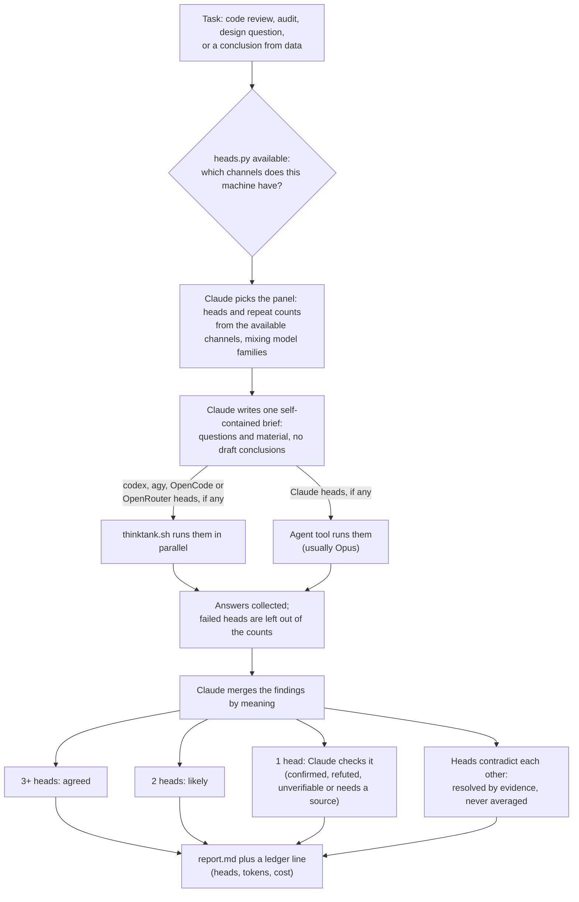
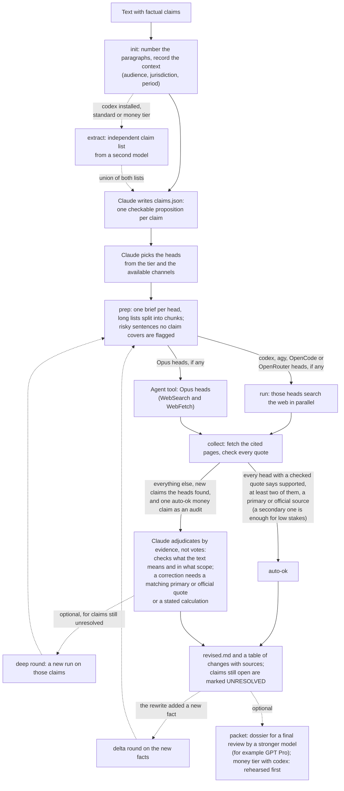

# thinktank (Claude Code plugin)

Two skills:

- `/thinktank:thinktank` fans one self-contained brief to several cheap LLM heads in parallel (codex, Gemini via agy, Opus via the Agent tool), merges findings by agreement, verifies single-head findings and reports tokens. For code reviews, audits, brainstorms, architecture questions and conclusions from data.
- `/thinktank:factcheck` checks a text claim by claim with web-enabled heads, verifies every cited quote against the live page, and writes a corrected text with sources. Optionally it also writes a dossier for a final review by a stronger model (for example GPT Pro); nothing requires one.

## How it works

**ThinkTank.** One brief goes to several independent heads at once. Agreement between heads is the signal; a finding only one head saw is checked by the orchestrator before it reaches the report.



With only Claude available, the runner is skipped: three Opus heads for reviews and data conclusions, two Opus and one Sonnet for brainstorms, two Opus for narrow questions, and the report says "single model family". With fewer than three live heads the report is labeled "degraded panel". Anything a head says needs a source is checked against a real source or marked unverified.

**FactCheck.** Every claim is checked against the web by several heads. A script then fetches each cited page and checks the quotes: exact and near-exact matches count, and a quote from a page this machine cannot read counts only when two heads bring it independently (for money claims Claude opens such pages itself). Verdicts without such evidence do not count.



If fewer than two heads return a usable answer, the run is labeled "degraded" and Claude checks every claim itself.

## Install

```
/plugin marketplace add tony8stark/thinktank
/plugin install thinktank@thinktank
```

Optional reminder hook: copy `hooks/thinktank-check.sh` somewhere and register it as a `UserPromptSubmit` hook in `~/.claude/settings.json`.

## Requirements

Only Claude Code is required. The skills detect what else is installed and size the panel from it:

| installed | panel |
|-----------|-------|
| Claude Code only | Opus (and Sonnet) heads via the Agent tool; works, but one model family shares blind spots |
| + [codex CLI](https://github.com/openai/codex), signed in | codex heads (`gpt-6.1-sol`, low effort) carry the repeats, Opus adds a second family; recommended |
| + `agy` (Antigravity CLI) | adds a Gemini head |
| + `OPENROUTER_API_KEY` in the environment | OpenRouter heads (`or-gpt`, `or-gemini`, `or-deepseek`): other model families without installing their CLIs; paid per call |
| + [OpenCode](https://opencode.ai) CLI | any model you have set up in OpenCode, once you add a head for it (below) |

Also `python3`; for factcheck, `pdftotext` (PDF quotes) and Google Chrome (headless fetches of JS pages).

Check what this machine has: `python3 scripts/heads.py available` and `python3 scripts/heads.py list`.

## Adding or changing heads

Heads live in `scripts/heads.json`. Put your own in `~/.config/thinktank/heads.json` (or point `THINKTANK_HEADS` at a file): same shape, an entry replaces the default of that name, `null` removes one. Example with an OpenCode head and a different OpenRouter model:

```json
{
  "heads": {
    "oc-kimi": {"channel": "opencode", "model": "openrouter/moonshotai/kimi-k3", "effort": "-", "family": "moonshot", "web": true},
    "or-deepseek": {"channel": "openrouter", "model": "deepseek/deepseek-v4.1-flash", "effort": "-", "family": "deepseek", "web": true},
    "astra": null
  }
}
```

`channel` is `codex`, `agy`, `opencode`, `openrouter` or `agent`; `model` is the id that channel expects (`provider/model`; for OpenCode take it from `opencode models`, for OpenRouter from openrouter.ai/models); `family` is used to keep panels mixed; `web: true` lets factcheck use the head. OpenCode heads run with every tool denied except `websearch` and `webfetch` (factcheck), through `OPENCODE_PERMISSION`.

## Layout

- `skills/thinktank/` SKILL.md, brief template
- `skills/factcheck/` SKILL.md, checker and extraction briefs
- `scripts/heads.json` head registry, `scripts/heads.py` registry loader, channel detection and the OpenRouter and OpenCode channels
- `scripts/thinktank.sh` parallel runner (writes `out/<head>.md` + `.meta.json`), `scripts/ledger.py`
- `scripts/factcheck.py` (setup, init, extract, prep, run, collect, packet, rehearse, pro; see its docstring). `factcheck.py setup` creates a restricted agy project `factcheck` (read_url + search_web only).
- `hooks/thinktank-check.sh` UserPromptSubmit reminder.

Runs go to `~/.local/share/thinktank/runs/`, ledgers to `~/.claude/thinktank/` (override with `THINKTANK_LEDGER`, `FACTCHECK_LEDGER`).

Tests: `uv run --with pytest pytest tests/` (no network, fake CLIs). `bash tests/test_runner.sh` calls the real codex.
